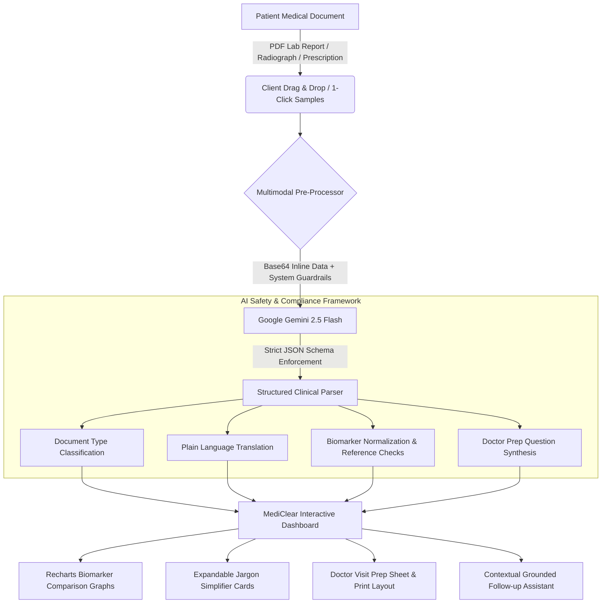

# MediClear AI (SehatLens AI) 🩺⚡
### *AI-Powered Health Literacy & Patient Empowerment Platform*
> **University AI Hackathon Submission**  
> **Theme:** UN Sustainable Development Goal 3 (SDG 3) – *AI for Accessible Healthcare & Well-Being*  
> **Core Focus:** Health Literacy, Clinical Transparency & Patient Empowerment (Targets 3.8 & 3.b)

[](https://opensource.org/licenses/MIT)
[](https://ai.google.dev/)
[](https://sdgs.un.org/goals/goal3)
[](https://vite.dev)

---

## 🌟 Live Hackathon Demo Features (Instant 1-Click Evaluation)
Judges do not need to hunt for medical files or wait in line. MediClear AI includes **3 clickable pre-loaded synthetic clinical scenarios** directly next to the upload box:
1. **Sample 1: Comprehensive Metabolic & Lipid Panel (CBC & Lipid)** — Elevated LDL (154 mg/dL), triglycerides (210 mg/dL), fasting blood sugar (112 mg/dL), and HbA1c (5.9%).
2. **Sample 2: PA Chest X-Ray Radiograph** — High-fidelity simulated radiograph highlighting clear lung aeration, costophrenic angles, and borderline cardiothoracic enlargement (CTR 54%).
3. **Sample 3: Pharmacy Doctor Prescription Receipt** — Multi-drug maintenance regimen (Lisinopril 10mg, Metformin 500mg, Atorvastatin 20mg) with meal timing requirements and safety warnings.

---

## 1. 🎯 Problem Statement & UN SDG 3 Alignment

### The Global Crisis of Health Illiteracy
Over **88 million adults in the United States alone** and **more than 60% of populations across developing nations** have basic or below-basic health literacy. When patients receive laboratory test results, radiological imaging reports, or handwritten prescription notes:
- **Jargon Barrier:** Words like *"atherogenic dyslipidemia"*, *"impaired fasting glycaemia"*, or *"cardiomegaly"* induce intense anxiety and panic.
- **Lost Doctor Appointments:** The average clinical consultation lasts only **12 to 15 minutes**. Patients enter appointments unprepared, forget to ask critical questions, and leave without understanding their care plan.
- **Medication Non-Adherence:** Over **50% of chronic medications** are taken incorrectly or prematurely abandoned due to confusing timing instructions or fear of side effects.

### Direct UN SDG 3 Target Mapping
| UN SDG 3 Target | MediClear AI Impact |
| :--- | :--- |
| **Target 3.4 (Non-Communicable Diseases)** | Early detection & preventive intervention for cardiovascular diseases, hypertension, and diabetes via biomarker risk visualization. |
| **Target 3.8 (Universal Health Coverage & Access)** | Democratizes medical literacy by transforming obscure diagnostic papers into patient-friendly, bilingual explanations accessible on any smartphone. |
| **Target 3.b (Affordable Healthcare & Medicine Adherence)** | Prevents costly complications through structured medication schedule timelines and doctor visit preparation. |

---

## 2. 👥 Target Users & Health Literacy Impact

1. **Chronic Condition Patients (Hypertension, Diabetes, High Cholesterol):**
   - Need ongoing visibility into whether their lifestyle adjustments or medications are shifting biomarkers in the right direction.
2. **Elderly Patients & Family Caregivers:**
   - Adult children managing elderly parents' complex medication schedules and specialist lab reports.
3. **Low-Literacy & Multilingual Communities (Urdu / Regional Dialects):**
   - High accessibility with full bilingual support (English and Simple Urdu / Roman Urdu script), bridging regional health equity divides.
4. **Physicians & Clinical Staff:**
   - Benefit from patients arriving with a neat, prioritized **"Doctor Visit Sheet"** containing specific, relevant questions rather than generic internet anxiety.

---

## 3. 🧠 AI Architecture & Multimodal Pipeline



### Key Technical Innovations
- **Multimodal Native Processing:** Powered by `gemini-2.5-flash` (with automatic fallback to `gemini-1.5-flash`). Directly ingests high-resolution images, multi-page PDFs, and scanned receipts without fragile external OCR pipelines.
- **Strict Structured JSON Schema:** The AI output is constrained to a typed JSON schema enforcing parameter names, units, clinical normal ranges, status tags (`Normal`, `Borderline`, `Needs Attention`), and normalized chart scores.
- **Medical Safety Guardrail Prompting:** System instructions prohibit definitive clinical pronouncements, forbid prescribing drugs, and mandatorily stamp educational disclaimers.
- **Client-Side Privacy:** API keys and document payloads can run directly client-side or through secure environment variables without persisting patient health information on third-party databases.

---

## 4. 💼 Business Sustainability & Startup Model

MediClear AI is designed as a sustainable social enterprise combining a B2C freemium utility with high-margin B2B health system partnerships:

```
+-----------------------------------------------------------------------------------------+
|                                    REVENUE STREAMS                                      |
+----------------------------------------------------+------------------------------------+
|                B2C FREEMIUM MODEL                  |     B2B DIAGNOSTIC LAB PARTNERS    |
+----------------------------------------------------+------------------------------------+
| • Free Tier: 3 report analyses / month             | • White-label "Smart Report API"   |
| • Patient Pro ($4.99/mo):                          | • Diagnostic chains (e.g., Quest,  |
|   - Unlimited lab & imaging scans                  |   LabCorp, Chughtai Lab, Essa)     |
|   - Longitudinal health trends graph               | • Co-branded QR code on paper labs |
|   - Family caregiver profiles (up to 5 members)   | • $0.15 - $0.35 per report scan    |
+----------------------------------------------------+------------------------------------+
```

### Strategic Go-To-Market
1. **Phase 1 (Hackathon to Pilot):** University health clinics & community medical camps providing free literacy reports.
2. **Phase 2 (Lab Integrations):** Partnering with independent pathology labs that want to modernize their archaic PDF reports into interactive patient portals.
3. **Phase 3 (Pharmacy Alliances):** Pharmacy chains printing a "MediClear Schedule QR" on pill packaging to reduce dosage errors.

---

## 5. 🚀 Local Setup & Installation

### Prerequisites
- Node.js `v18.0.0` or higher (tested on Node `v22.14.0`)
- npm `v9.0.0` or higher
- A free Google Gemini API Key from [Google AI Studio](https://aistudio.google.com/app/apikey)

### Quick Start (3 Steps)

```bash
# 1. Navigate to the project directory
cd mediclear-ai

# 2. Install dependencies
npm install

# 3. Create .env file (or enter key directly in app UI)
cp .env.example .env
# Edit .env and paste your GEMINI API KEY:
# VITE_GEMINI_API_KEY=AIzaSy...

# 4. Start Vite development server
npm run dev
```

The application will be live at: **`http://localhost:5173`**

### In-App Key Configuration
If you do not want to create a `.env` file, simply start the app and click the **"Gemini API"** button in the top navigation bar. You can paste your key directly into the secure browser modal, test the connection with 1 click, and run live analyses!

---

## 6. ⚖️ Ethical AI, Medical Disclaimer & Compliance Rule

> **Mandatory Medical Disclaimer:**  
> MediClear AI is strictly an **educational and health literacy support application**. It does **NOT** provide medical diagnosis, clinical treatment plans, or emergency triage. It is not a medical device. Patients must always consult with a licensed, certified healthcare provider for clinical interpretation and medical decisions.

### Hackathon Compliance Guardrails
- Prominent persistent safety banner on every page.
- Mandatory medical disclaimer embedded into all exported and printed Doctor Visit Sheets.
- Non-prescriptive lifestyle and wellness suggestions only (dietary hydration, sleep hygiene, symptom logging).

---

## 7. 🛠️ Tech Stack Details
- **Frontend Core:** React 19, TypeScript, Vite 6
- **Styling & Design System:** Tailwind CSS v4, Lucide React Medical Icons
- **Data Visualization:** Recharts (Normalized reference range comparisons, daily dosage timeline)
- **AI Engine:** Google Gemini 2.5 Flash (`@google/genai` & Google Generative Language REST API)
- **Delight & Print:** Canvas-Confetti, Native Print CSS Engine

---

*MediClear AI — Empowering Every Patient with Clarity, Dignity, and Confidence.*
